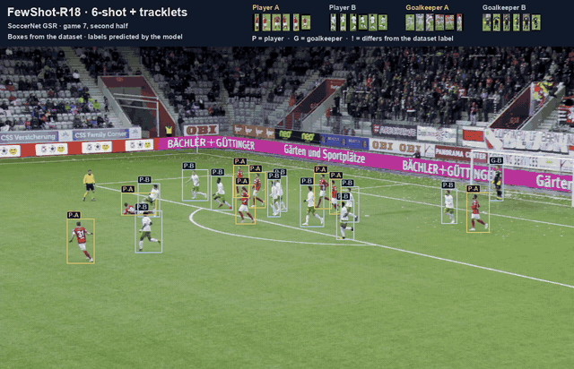
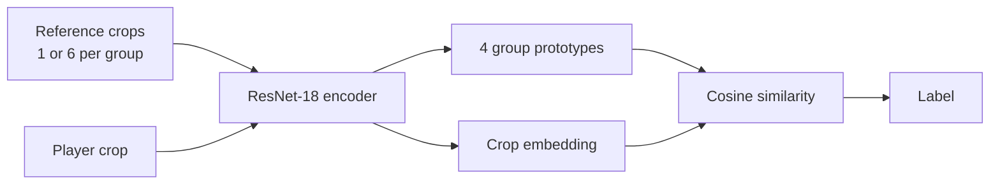

# FewShot-R18: few-shot team and goalkeeper assignment


Sorts the players of a football match into four groups — **team A, team B, goalkeeper A, goalkeeper B** — from a few example crops of each group taken earlier in the same match. The model, **FewShot-R18**, is a ResNet-18 trained to compare each player with those examples; it works with one example per group (1-shot) or six (6-shot).

<p align="center">
  <a href="media/classification-game-7-6shot-tracklets.mp4"></a>
</p>

**FewShot-R18 with six references per group and tracklet averaging, on a match it never saw in training.** The model was trained on matches 4, 6 and 9; this is match 7. The 24 reference crops at the top come from earlier in the same half. All 2,443 boxes in this 12-second clip get the right label; on the full six-match benchmark the score is 97.45%. Boxes and track IDs come from the SoccerNet annotations. Orange and blue are the two teams, `P` is an outfield player and `G` a goalkeeper.

[Full-resolution video](media/classification-game-7-6shot-tracklets.mp4) · [Clip metrics](media/classification-game-7-6shot-tracklets-stats.json) · [1-shot version, no tracklets](media/classification-game-7.mp4)

## Results

Three matches never seen in training, 2,659 player boxes. **Score** is the average of the four groups' accuracies, so each goalkeeper group counts as much as each team, even though goalkeepers are only 6% of the boxes.

| Model | Score | Team A | Team B | Goalkeeper A | Goalkeeper B |
|---|---:|---:|---:|---:|---:|
| ImageNet ResNet-18, not fine-tuned, one reference | 48.06% | 57.22% | 55.27% | 40.26% | 39.51% |
| **FewShot-R18, 1-shot** | **86.10%** | 96.05% | 97.73% | 75.32% | 75.31% |
| **FewShot-R18, 6-shot** | **93.81%** | 96.45% | 97.89% | 88.31% | 92.59% |

- **Across all nine matches**, each held out in turn: **85.04%** on 9,130 boxes.
- **Five training seeds:** 89.00% ± 2.86 (one reference).
- **Better than appearance baselines** with the same six references: our model 94.10%, torso colour 85.02%, person re-identification (OSNet) 80.72% (averages over 30 random reference choices).

### Against other methods

Same 5,842 boxes from six held-out matches (2, 3, 5, 7, 8, 11), with the same tracklets and pitch positions for every method.

| Method | Labelled crops | Score | Team A | Team B | Goalkeeper A | Goalkeeper B |
|---|:---:|---:|---:|---:|---:|---:|
| SoccerNet baseline (PRTReID + K-means) | none | 66.15% | 71.84% | 76.53% | 57.42% | 58.82% |
| Roboflow pipeline (SigLIP + UMAP + K-means) | none | 70.85% | 84.18% | 84.14% | 57.42% | 57.65% |
| Frozen CLIP, same references, tracklets | 6 per group | 82.17% | 93.32% | 73.20% | 90.97% | 71.18% |
| Frozen SigLIP, same references, tracklets | 6 per group | 87.98% | 94.38% | 84.10% | 92.26% | 81.18% |
| **FewShot-R18, 6-shot, averaged over each tracklet** | 6 per group | **97.45%** | 96.88% | 99.57% | 98.06% | 95.29% |
| FewShot-R18, 6-shot, each box alone | 6 per group | 92.42% | 92.13% | 94.28% | 90.32% | 92.94% |

The SoccerNet and Roboflow pipelines take the player/goalkeeper role of each box from PRTReID's role head. Boxes the pipeline leaves without a team count as errors: 484 of 5,842 with predicted roles (voted referee, other or ball, or no pitch position). Given the true role of every box instead, the Roboflow pipeline reaches 96.05%. That number is not directly comparable: the method is handed the hardest part of the task, while FewShot-R18 decides roles itself. FewShot-R18 still scores higher with tracklets.

- **Matches 7, 8, 11:** 98.98% against 83.55% for the SoccerNet baseline.
- **Matches 2, 3, 5:** 96.08% against 50.93%. In match 3 the baseline labels 418 of its 1,072 boxes as referees or the ball.

**Another dataset, no retraining.** On [SoccerTrack](https://github.com/AtomScott/SoccerTrack) (a fixed 8K fish-eye camera, small players, two teams, no goalkeeper labels), 12 clips from one match, 30 reference draws, queries excluding the reference athletes. Score is the mean of the two team accuracies, tracklets averaged:

| Method | 1 reference | 6 references |
|---|---:|---:|
| **FewShot-R18, trained 1-shot** | **84.24%** | **85.39%** |
| HSV torso colour | 82.00% | 84.44% |
| Frozen OSNet (re-identification) | 70.67% | 74.36% |
| Frozen ImageNet ResNet-18 | 65.43% | 70.50% |
| Frozen SigLIP | 57.55% | 60.18% |
| Frozen CLIP | 56.85% | 60.68% |
| Roboflow pipeline | 54.57% | 56.35% |

FewShot-R18 is the best method in every setting; colour is second. Goalkeepers carry their team's label here. Details: [`results/transfer-soccertrack.json`](results/transfer-soccertrack.json).

Details in [RESEARCH.md](RESEARCH.md) and the [preprint](paper/main.pdf).

## Speed

**Encoder cost** for 20 player crops, Apple M4 Pro:

| Encoder | Input | Parameters | Operations per crop | CPU | Mac GPU |
|---|---|---:|---:|---:|---:|
| **FewShot-R18** | 96×48 | **11.2 M** | **0.18 billion** | **99 ms** | **5.5 ms** |
| CLIP ViT-B/32 | 224×224 | 87.5 M | 4.36 billion | 99 ms | 53 ms |
| SigLIP base (Roboflow pipeline) | 224×224 | 92.9 M | 17.00 billion | 446 ms | 194 ms |
| PRTReID (SoccerNet baseline) | 256×128 | 33.4 M | 5.31 billion | 2,201 ms | – |

PRTReID requires PyTorch 1.13.1, which crashes on the Mac GPU; it was timed on CPU in that version, where ours takes 123 ms. The others use PyTorch 2.9.1. The Roboflow pipeline also runs UMAP and K-means once per clip (about 21 ms). Details: [general encoders](results/speed-general-encoders.json), [PRTReID](results/speed-comparison.json).

**On an Apple M4 Pro**, six-reference model, 20 player crops per batch:

| Runtime | Score | Time |
|---|---:|---:|
| PyTorch GPU, FP32 | 93.81% | 6.17 ms |
| Core ML GPU, INT8 | 93.81% | 2.99 ms |
| **Core ML Neural Engine, INT8** | **93.79%** | **2.24 ms** |

**NVIDIA GPUs**, TensorRT, 20 player crops per batch:

| Format | Score, RTX 3060 | Time, RTX 3060 | Score, RTX 5070 Ti | Time, RTX 5070 Ti |
|---|---:|---:|---:|---:|
| FP16 | 93.81% | 0.58 ms | 93.81% | 0.40 ms |
| INT8 | 93.79% | 0.52 ms | 93.83% | 0.58 ms |
| FP8 | – | – | 93.44% | 0.65 ms |
| FP16, 2:4 sparse | 94.53% | 0.56 ms | 94.53% | 0.39 ms |
| INT8, 2:4 sparse | 94.50% | 0.49 ms | 94.84% | 0.63 ms |

The 2:4 sparse model has half of its convolution weights set to zero and was fine-tuned with that pattern; it scores slightly higher than the dense model, but with the same weights the sparse kernels are at most 7% faster in FP16 and slower in INT8. TensorRT has no 4-bit convolution kernels; simulated, INT4 scores 94.09% and NVFP4 93.95%. Details: [RTX 3060](results/gpu-formats-rtx3060.json), [RTX 5070 Ti](results/gpu-formats-rtx5070ti.json), [2:4 fine-tune](results/sparse24.json).

## How it works



Every crop becomes a 512-number vector. The references of each group are averaged into one vector, and each player gets the group it is closest to. "Team A" is whoever is in the team A references, so the same model works for any kit colours. Player boxes are the input; detection and tracking are separate.

## Use it

```python
import torch
import six_references
import train

device = torch.device("mps" if torch.backends.mps.is_available() else "cpu")
model = train.build_model("data/inputs/resnet18.pth", device)
model.load_state_dict(torch.load("models/six-references.pth", map_location=device, weights_only=True)["model"])
model.eval()

with torch.inference_mode():
    groups = six_references.class_prototypes(model(six_references.batch_crops(reference_crops, device)), 6)
    players = model(six_references.batch_crops(box_crops, device))
labels = train.cosine_logits(players, groups).argmax(dim=1).tolist()
```

`reference_crops` holds six 96×48 crops per group, in the order team A, team B, goalkeeper A, goalkeeper B. `box_crops` holds the players to label. Use `prepare.crop_box(image, box)` to cut a crop from a frame. Only the ImageNet weights from `download.sh` are needed, not the dataset.

On a Mac, the Core ML model runs on the Neural Engine:

```python
import coremltools as ct
import numpy as np
import six_references
import torch

encoder = ct.models.MLModel("models/six-references-int8.mlpackage", compute_units=ct.ComputeUnit.CPU_AND_NE)

def embed(crops):
    data = six_references.batch_crops(crops, torch.device("cpu")).numpy()
    out = []
    for start in range(0, len(data), 20):
        chunk = data[start:start + 20]
        count = len(chunk)
        chunk = np.concatenate((chunk, np.repeat(chunk[-1:], 20 - count, axis=0)))
        out.append(encoder.predict({"crops": chunk})["embedding"][:count])
    vectors = np.concatenate(out)
    return vectors / np.linalg.norm(vectors, axis=1, keepdims=True)

groups = embed(reference_crops).reshape(4, 6, -1).mean(axis=1)
groups /= np.linalg.norm(groups, axis=1, keepdims=True)
labels = (embed(box_crops) @ groups.T).argmax(axis=1)
```

## Models

| File | Description |
|---|---|
| [`models/one-reference.pth`](models/one-reference.pth) | FewShot-R18, 1-shot |
| [`models/six-references.pth`](models/six-references.pth) | FewShot-R18, 6-shot |
| [`models/six-references-fp16.pth`](models/six-references-fp16.pth) | FewShot-R18, 6-shot, half the size |
| [`models/six-references-int8.mlpackage`](models/six-references-int8.mlpackage) | FewShot-R18, 6-shot, Core ML INT8 |

Checksums: [`models/SHA256SUMS`](models/SHA256SUMS).

## Train it yourself

```bash
python -m venv .venv && source .venv/bin/activate
pip install -r requirements.txt
./download.sh     # SoccerNet GSR 2025 (~30 GB) and ImageNet weights
./run.sh          # prepares the data and trains both models
```

Core ML export (macOS):

```bash
pip install -r requirements-coreml.txt
mkdir -p data/work/export
python quantize.py --root "$PWD/data" --checkpoint data/work/six-references/checkpoint.pth --out data/work/export
```

## Repository layout

```text
.
├── prepare.py, train.py, reference_bank.py, six_references.py
├── quantize.py, evaluate_formats.py, benchmark.py, visualize.py
├── run.sh, download.sh, requirements*.txt
├── README.md, RESEARCH.md, LICENSE, NOTICE.md, checksums.sha256
├── experiments/       Research and evaluation scripts; see its README
├── tests/             Unit tests
├── models/            Trained checkpoints and Core ML package
├── results/           Evaluation results and logs; see its README
├── media/             Demonstration video and example frames
├── dataset-audit/     Standalone SoccerNet label audit
└── paper/             Preprint (LaTeX source and PDF)
```

## Dataset audit

See [`dataset-audit/`](dataset-audit/) for the standalone audit and [SoccerNet issue #39](https://github.com/SoccerNet/sn-gamestate/issues/39).

## License

Code: [MIT](LICENSE). Dataset, video frames and ImageNet weights: see [NOTICE.md](NOTICE.md).
