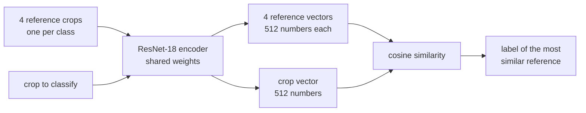
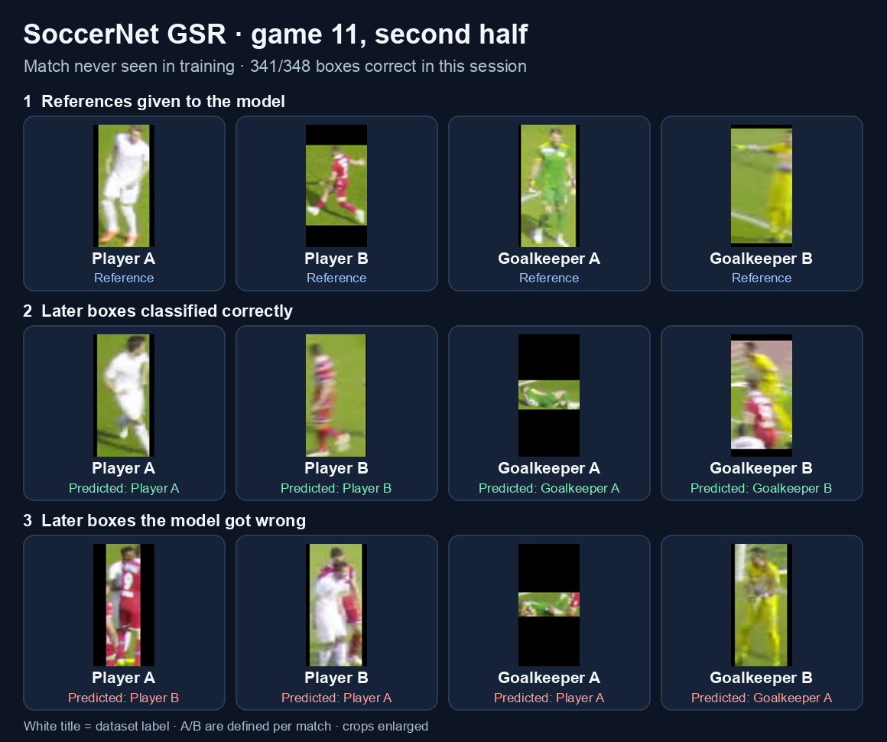
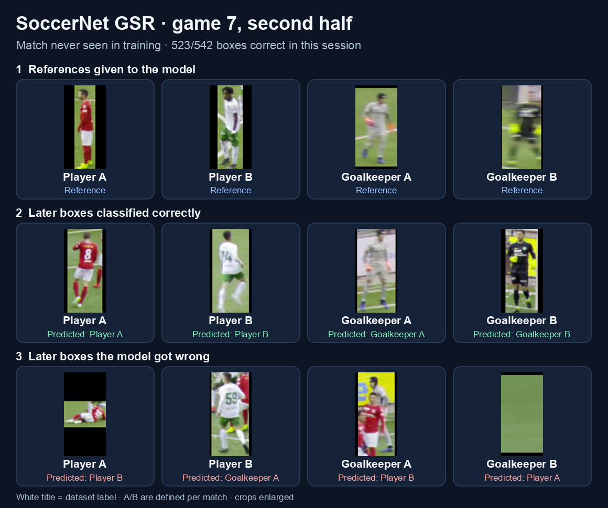

# Four-Reference Team Classifier


You already have the player boxes of a football match. You show the model **one example of each group** — an outfield player of each team and the goalkeeper of each team — and it labels every other box of that match.

A ResNet-18 fine-tuned for this comparison labels **91.65% of 2,671 boxes** correctly in three matches it never saw during training. The same network with untouched ImageNet weights, given the same references and the same boxes, gets **53.61%**.

<p align="center">
  
</p>

Twelve seconds of a test match ([full-resolution video](media/classification-game-7.mp4)). The boxes come from the dataset annotations; the model assigns each label one box at a time, with no tracking and no smoothing across frames. Orange is team A, blue is team B, `P` is an outfield player, `G` is a goalkeeper, and `!` marks a prediction that differs from the dataset label.

## The task

| | |
|---|---|
| **Given once per match** | Four reference crops: player A, player B, goalkeeper A, goalkeeper B |
| **Given afterwards** | Any number of player crops from the same match |
| **Returned** | One of the four labels for each crop |

There is no detector and no tracker here: boxes are an input. "Team A" has no fixed appearance either. It can wear red in one match and white in the next, so the model cannot learn "red means A". It has to learn to compare a crop with the references it was handed.

## How it works



The four reference vectors are computed once per match. After that, each new box costs one forward pass and four dot products.

### What was changed in ResNet-18

The residual blocks are the standard torchvision ones. Three things around them changed:

| | torchvision ResNet-18 | This repository |
|---|---|---|
| **Output** | 1,000-way ImageNet classifier | Classifier removed; the network returns a 512-number vector per crop |
| **Weights** | ImageNet | Stem, `layer1` and `layer2` kept frozen (0.68 M parameters); `layer3` and `layer4` fine-tuned (10.49 M); batch-norm running statistics kept from ImageNet |
| **Decision** | Fixed set of classes | Cosine similarity between the crop vector and the four reference vectors of that match; the highest wins |
| **Input** | 224 × 224 image | 96 × 48 crop, aspect ratio preserved on a black canvas |

### How it is trained

Training repeats the task itself. Each step draws one session (one half of one match), one reference per class from the early part of it, and up to four later boxes per class. The loss is cross-entropy over the four similarities, so the correct reference has to score highest.

For outfield players, the boxes to classify always belong to **a different athlete** than the reference of that class, identified by jersey number. This forces the network to match the kit instead of the person.

The run is 8 epochs of 180 steps with AdamW (learning rate 2e-4, weight decay 1e-4, cosine schedule) and seed 25. On an Apple-silicon GPU it takes about one minute.

## Data

[SoccerNet Game State Reconstruction 2025](https://huggingface.co/datasets/SoccerNet/SN-GSR-2025) provides 30-second broadcast clips in which every box carries a role (`player`, `goalkeeper`, …) and a team (`left` or `right`). Here `left` is team A and `right` is team B.

Many clips show only one of the goalkeepers, so `prepare.py` pools the clips of the same match and the same half into one **session**, samples up to 96 frames from it, and picks a cut-off time: references come from before the cut-off, the boxes to classify from after it.

| Split | Matches (dataset `game_id`) | Clips | Sessions | Crops |
|---|---|---:|---:|---:|
| Train | 4, 6, 9 | 57 | 6 | 7,161 |
| Validation | 2, 3, 5 | 58 | 6 | 7,308 |
| Test | 7, 8, 11 | 49 | 6 | 6,441 |

Referees, the ball and other people are ignored. Outfield players whose jersey number is not annotated (3,410 boxes) are left out, because without a number the "different athlete" rule cannot be checked.

### Why the test score is not memorisation

- **Whole matches are held out.** The three splits share no `game_id`; `prepare.py` refuses to continue otherwise and the audit is in [`results/audit.json`](results/audit.json).
- **No crop appears twice.** Pixel hashes of all 20,910 crops show zero duplicates across splits ([`results/verification.json`](results/verification.json)).
- **The test set was opened once.** The checkpoint (epoch 6) was chosen by validation accuracy before any test crop was read; the order is visible in [`results/training.log`](results/training.log).
- **References come first.** Every evaluated box is later in the match than the four references.
- **Other athletes.** Evaluated outfield boxes never share the jersey number of their class reference.
- **Same boxes for the baseline.** The frozen ImageNet ResNet-18 is scored on exactly the same references and boxes.

## Results

Test split: three matches, six sessions, 2,671 boxes.

| | Boxes | Frozen ImageNet ResNet-18 | Fine-tuned ResNet-18 |
|---|---:|---:|---:|
| Player, team A | 1,295 | 54.90% | **90.50%** |
| Player, team B | 1,218 | 54.02% | **93.84%** |
| Goalkeeper, team A | 77 | 40.26% | **83.12%** |
| Goalkeeper, team B | 81 | 39.51% | **85.19%** |
| **All boxes** | **2,671** | **53.61%** | **91.65%** |
| **Mean of the four classes** | — | **47.17%** | **88.16%** |

Per match:

| Test match | Boxes | Frozen | Fine-tuned |
|---|---:|---:|---:|
| Game 7 | 843 | 39.38% | 81.14% |
| Game 8 | 1,030 | 61.84% | 96.21% |
| Game 11 | 798 | 58.02% | 96.87% |

On the validation matches the fine-tuned model reaches 85.03% of 3,193 boxes (88.09% class mean) against 54.87% (50.42%) for the frozen one. Full confusion matrices, per-session numbers and the split audit are in [`results/result.json`](results/result.json).

## What it looks like

Each sheet shows the four references the model received, one later box per class it labelled correctly, and one it got wrong. Both matches are from the test split.

<p align="center">
  
  
</p>

Team A wears white in game 11 and red in game 7: the label follows the references, not a colour. Game 7, second half, is the hardest session (75.63%); one of its mistakes is a box annotated as goalkeeper B that shows almost only grass.

About the video at the top: the 12-second window was picked because both goalkeepers are visible in it, not for its score. In that window 2,368 of 2,443 boxes (96.93%) match the dataset label ([stats](media/classification-game-7-stats.json)). It draws every labelled player box of consecutive frames from a single clip, so it is not the same population as the test metric, and it is easier than the full session it belongs to.

<p align="center">
  
</p>

## Reproduce

```bash
python -m venv .venv && source .venv/bin/activate
pip install -r requirements.txt

./download.sh                                 # pinned dataset revision (~30 GB) and ImageNet weights
./run.sh                                      # verify checksums, build sessions, train, test
python visualize.py --root data --out media   # example sheets, video and GIF (needs ffmpeg)
```

`run.sh` writes `data/work/result.json` and `data/work/checkpoint.pth`. Re-running these exact scripts on the same machine (Apple-silicon GPU, PyTorch 2.9.1) reproduced `results/result.json` and the checkpoint byte for byte. Other hardware or library versions may differ in the last digits.

The trained weights are attached to the [v1.0 release](https://github.com/Hmenez3s/four-reference-team-classifier/releases/tag/v1.0) (`checkpoint.pth`, SHA-256 `e85b9de6153db41c3dac9a5139f81f1ca76a2db7aecc99610ade35b3ee5c210a`).

### Classify your own boxes

`prepare.crop_box(image, {"x_center": …, "y_center": …, "w": …, "h": …})` turns a box of a PIL image into the 96 × 48 crop the model expects. With the four reference crops stacked in class order and the boxes to classify stacked in a second array:

```python
import torch
import train

device = torch.device("mps" if torch.backends.mps.is_available() else "cpu")
model = train.build_model("data/inputs/resnet18.pth", device)
state = torch.load("data/work/checkpoint.pth", map_location=device, weights_only=True)
model.load_state_dict(state["model"])
model.eval()

with torch.no_grad():
    references = model(train.batch_images({"x": reference_crops}, [0, 1, 2, 3], device))
    boxes = model(train.batch_images({"x": box_crops}, list(range(len(box_crops))), device))
labels = train.cosine_logits(boxes, references).argmax(dim=1).tolist()
```

`reference_crops` is a `uint8` array of shape `[4, 96, 48, 3]` ordered as `train.CLASSES`; `box_crops` has shape `[N, 96, 48, 3]`; `labels` holds an index into `train.CLASSES` for each box.

## Limits

- **Small test.** Three test matches and one training seed. Accuracy per match ranges from 81.14% to 96.87%, and there are no confidence intervals. Read 91.65% as "it worked on these three matches", not as an expected score on any match.
- **Goalkeepers are the weak spot.** 83–85%, measured on only 77 and 81 boxes.
- **One set of references per session.** Each session was scored with a single deterministic choice of the four references; the sensitivity to which crop is used as a reference was not measured.
- **Ground-truth boxes.** Boxes come from the annotations. Errors of a real detector are not part of the score.
- **Four classes only.** The model always answers one of the four labels. A referee, a substitute or an empty box would still receive one.
- **Per-half sessions.** The dataset's `left`/`right` team labels are assumed stable within a half; references are not carried across half-time.
- **Annotated numbers only.** Outfield players without an annotated jersey number are excluded from training and from the reported metric.

## Repository layout

| Path | Purpose |
|---|---|
| `download.sh` | Fetches the pinned dataset revision and the ImageNet ResNet-18 weights into `data/` |
| `checksums.sha256` | SHA-256 of every downloaded file, checked by `run.sh` |
| `prepare.py` | Builds match-disjoint sessions and letterboxed crops straight from the ZIP archives |
| `train.py` | Model, episodic training, validation-based checkpoint selection and the test evaluation |
| `visualize.py` | Example sheets, the classified video and its GIF |
| `run.sh` | Runs checksum verification, `prepare.py` and `train.py` in order |
| `results/` | Metrics, split audit, duplicate-crop check and training log of the reported run |
| `media/` | Images and video shown in this README |

## License

The code is released under the [MIT License](LICENSE). The dataset, the frames shown in `media/` and the ImageNet weights are third-party material under their own terms; see [NOTICE.md](NOTICE.md).
