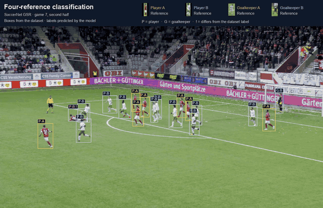
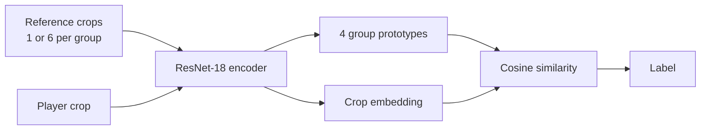

# Four-Reference Team Classifier


Sorts the players of a football match into four groups — **team A, team B, goalkeeper A, goalkeeper B** — from a few example crops of each group taken earlier in the same match.

<p align="center">
  <a href="media/classification-game-7.mp4"></a>
</p>

Orange and blue are the two teams, `P` is an outfield player, `G` a goalkeeper, `!` a wrong label. [Full-resolution video](media/classification-game-7.mp4).

## Results

Three matches never seen in training, 2,659 player boxes. **Score** is the average of the four groups' accuracies, so each goalkeeper group counts as much as each team, even though goalkeepers are only 6% of the boxes.

| Model | Score | Team A | Team B | Goalkeeper A | Goalkeeper B |
|---|---:|---:|---:|---:|---:|
| ImageNet ResNet-18, not fine-tuned, one reference | 48.06% | 57.22% | 55.27% | 40.26% | 39.51% |
| **One reference per group** | **86.10%** | 96.05% | 97.73% | 75.32% | 75.31% |
| **Six references per group** | **93.81%** | 96.45% | 97.89% | 88.31% | 92.59% |

- **Across all nine matches**, each held out in turn: **85.04%** on 9,130 boxes.
- **Five training seeds:** 89.00% ± 2.86 (one reference).
- **Better than appearance baselines** with the same six references: our model 94.10%, torso colour 85.02%, person re-identification (OSNet) 80.72% (averages over 30 random reference choices).

### Against the official SoccerNet method

Same 5,842 boxes from six held-out matches (2, 3, 5, 7, 8, 11), with the same tracklets and pitch positions given to both methods. The SoccerNet baseline clusters PRTReID embeddings with K-means; its published weights were trained on other matches.

| Method | Score | Team A | Team B | Goalkeeper A | Goalkeeper B |
|---|---:|---:|---:|---:|---:|
| SoccerNet baseline (PRTReID + K-means) | 66.15% | 71.84% | 76.53% | 57.42% | 58.82% |
| **Six references, averaged over each tracklet** | **97.45%** | 96.88% | 99.57% | 98.06% | 95.29% |
| Six references, each box alone | 92.42% | 92.13% | 94.28% | 90.32% | 92.94% |

- **Matches 7, 8, 11:** 98.98% against 83.55%.
- **Matches 2, 3, 5:** 96.08% against 50.93%. In match 3 the baseline labels 418 of its 1,072 boxes as referees or the ball.

Details in [RESEARCH.md](RESEARCH.md) and the [preprint](paper/main.pdf).

## Speed

Apple M4 Pro, 20 player crops per batch, six-reference model:

| Runtime | Score | Time |
|---|---:|---:|
| PyTorch GPU, FP32 | 93.81% | 6.17 ms |
| Core ML GPU, INT8 | 93.81% | 2.99 ms |
| **Core ML Neural Engine, INT8** | **93.79%** | **2.24 ms** |

## How it works



Every crop becomes a 512-number vector. The references of each group are averaged into one vector, and each player gets the group it is closest to. "Team A" is whoever is in the team A references, so the same model works for any kit colours. Player boxes are the input; detection and tracking are separate.

## Use it

```python
import torch
import six_references
import train

device = torch.device("mps" if torch.backends.mps.is_available() else "cpu")
model = train.build_model("data/inputs/resnet18.pth", device)
model.load_state_dict(torch.load("models/six-references.pth", map_location=device, weights_only=True)["model"])
model.eval()

with torch.inference_mode():
    groups = six_references.class_prototypes(model(six_references.batch_crops(reference_crops, device)), 6)
    players = model(six_references.batch_crops(box_crops, device))
labels = train.cosine_logits(players, groups).argmax(dim=1).tolist()
```

`reference_crops` holds six 96×48 crops per group, in the order team A, team B, goalkeeper A, goalkeeper B. `box_crops` holds the players to label. Use `prepare.crop_box(image, box)` to cut a crop from a frame. Only the ImageNet weights from `download.sh` are needed, not the dataset.

On a Mac, the Core ML model runs on the Neural Engine:

```python
import coremltools as ct
import numpy as np
import six_references
import torch

encoder = ct.models.MLModel("models/six-references-int8.mlpackage", compute_units=ct.ComputeUnit.CPU_AND_NE)

def embed(crops):
    data = six_references.batch_crops(crops, torch.device("cpu")).numpy()
    out = []
    for start in range(0, len(data), 20):
        chunk = data[start:start + 20]
        count = len(chunk)
        chunk = np.concatenate((chunk, np.repeat(chunk[-1:], 20 - count, axis=0)))
        out.append(encoder.predict({"crops": chunk})["embedding"][:count])
    vectors = np.concatenate(out)
    return vectors / np.linalg.norm(vectors, axis=1, keepdims=True)

groups = embed(reference_crops).reshape(4, 6, -1).mean(axis=1)
groups /= np.linalg.norm(groups, axis=1, keepdims=True)
labels = (embed(box_crops) @ groups.T).argmax(axis=1)
```

## Models

| File | Description |
|---|---|
| [`models/one-reference.pth`](models/one-reference.pth) | One reference per group |
| [`models/six-references.pth`](models/six-references.pth) | Six references per group |
| [`models/six-references-fp16.pth`](models/six-references-fp16.pth) | Six references, half the size |
| [`models/six-references-int8.mlpackage`](models/six-references-int8.mlpackage) | Six references, Core ML INT8 |

Checksums: [`models/SHA256SUMS`](models/SHA256SUMS).

## Train it yourself

```bash
python -m venv .venv && source .venv/bin/activate
pip install -r requirements.txt
./download.sh     # SoccerNet GSR 2025 (~30 GB) and ImageNet weights
./run.sh          # prepares the data and trains both models
```

Core ML export (macOS):

```bash
pip install -r requirements-coreml.txt
mkdir -p data/work/export
python quantize.py --root "$PWD/data" --checkpoint data/work/six-references/checkpoint.pth --out data/work/export
```

## Repository layout

```text
.
├── prepare.py, train.py, reference_bank.py, six_references.py
├── quantize.py, evaluate_formats.py, benchmark.py, visualize.py
├── run.sh, download.sh, requirements*.txt
├── README.md, RESEARCH.md, LICENSE, NOTICE.md, checksums.sha256
├── experiments/       Research and evaluation scripts; see its README
├── tests/             Unit tests
├── models/            Trained checkpoints and Core ML package
├── results/           Evaluation results and logs; see its README
├── media/             Demonstration video and example frames
├── dataset-audit/     Standalone SoccerNet label audit
└── paper/             Preprint (LaTeX source and PDF)
```

## Dataset audit

See [`dataset-audit/`](dataset-audit/) for the standalone audit and [SoccerNet issue #39](https://github.com/SoccerNet/sn-gamestate/issues/39).

## License

Code: [MIT](LICENSE). Dataset, video frames and ImageNet weights: see [NOTICE.md](NOTICE.md).
