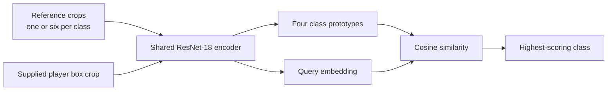

# Four-Reference Team Classifier


**Watch the classifier work:** this 12-second clip shows annotated player boxes labeled frame by frame. The boxes are supplied to the model; this project does not detect or track players.

<p align="center">
  <a href="media/classification-game-7.mp4"></a>
</p>

[Open the full-resolution video](media/classification-game-7.mp4). Orange and blue mark the two teams; `P` means outfield player, `G` goalkeeper, and `!` marks a prediction differing from the annotation. It is an illustrative window, not the evaluation set: all 2,443 boxes in the clip are shown, and its window was selected because both goalkeepers appear.

## What it does

Given example crops from a match half, classify each supplied player crop as one of four classes: outfield team A, outfield team B, goalkeeper A, or goalkeeper B. Team names are relative to the references and do not encode fixed kit colors. References are selected separately **for each half**; they are not carried across half-time.

This is a ResNet-18 encoder: it maps each 96×48 crop to a 512-value vector, then assigns the label whose reference vector has the highest cosine similarity. In six-reference mode, six crop embeddings per class are averaged into that class's prototype. Reference crops are encoded once per half; query crops can be batched. There is no detector, tracker, temporal smoothing, or unknown class: boxes are inputs and each receives one of the four labels.



## Evaluation

The evaluation aligns outfield team slots within each half using jersey-number consistency. Five outfield assignments were swapped after audit; goalkeeper slots are retained and are not swapped. This distinction matters because SoccerNet's `left` and `right` are camera-relative labels, not persistent team identities. Preparation audit details and protocol are in [RESEARCH.md](RESEARCH.md).

The **retrospective** evaluation uses later jersey labels to choose references and score only outfield athletes other than the reference athlete. The fixed test covers 2,659 boxes from games 7, 8, and 11:

| Model / condition | Accuracy | Macro recall |
|---|---:|---:|
| Frozen ImageNet ResNet-18, one reference per class | 55.28% | 48.06% |
| Tuned ResNet-18, one reference per class | 95.60% | 86.10% |
| Tuned ResNet-18, six references per class | 96.77% | 93.81% |

These results are retrospective, not deployment estimates. Five training seeds on the same split averaged 95.92% ± 0.70 percentage points accuracy (sample SD). Three rotated, whole-game-held-out folds yielded 89.11% accuracy over 9,130 boxes in nine games; these are internal SoccerNet folds, not external validation.

The **prospective replay** uses a timestamp-only schedule: the first 30% of available labeled timestamps form the bootstrap period; references are chosen only from early annotations, and later boxes are not filtered using jersey numbers. It scored 3,688 later boxes across **3 of 6 halves** for which all required goalkeeper references were available. The other halves lacked a usable labeled bootstrap crop for at least one goalkeeper class and are not included; this result does not establish coverage on other feeds or matches.

| Trained checkpoint | One early reference per class | Six early references per class |
|---|---:|---:|
| Trained with one reference | 96.29% | 97.02% |
| Trained with six references | 94.69% | 95.47% |

The two protocols score different query populations. The [research report](RESEARCH.md) gives the full protocol, the 30 paired reference draws, and the error analysis. The [overlap measurements](results/occlusion.json) are a box-based proxy, not proof of physical occlusion.

## Inference speed and formats

On an Apple M4 Pro, reported latency is the median for a batch of **20 prepared crops**, excluding video decoding, detection, and crop production. Accuracy below is the fixed retrospective 2,659-box result. These device/runtime results are actual measurements for the indicated formats; Core ML compute-unit choices are preferred placement, not per-operation execution traces.

| Runtime | Precision | Accuracy | Median per 20 crops |
|---|---|---:|---:|
| PyTorch GPU | FP32 | 96.77% | 6.17 ms |
| PyTorch GPU | FP16 | 96.77% | 5.90 ms |
| Core ML CPU | INT8 | 96.77% | 7.12 ms |
| Core ML GPU | INT8 | 96.73% | 2.99 ms |
| Core ML Neural Engine | FP16 | 96.77% | 2.55 ms |
| Core ML Neural Engine | INT8 | 96.69% | 2.24 ms |

FP16 PyTorch preserved predictions in the precision replay. INT8 quantizes both weights and activations; calibration used training games 4, 6, and 9 only. Per-device figures and the full protocol are in [RESEARCH.md](RESEARCH.md); see also the current format results at [`results/formats.json`](results/formats.json).

## Reproduce

Python dependencies are listed in [`requirements.txt`](requirements.txt); Core ML export/evaluation additionally requires macOS and [`requirements-coreml.txt`](requirements-coreml.txt).

```bash
python -m venv .venv
source .venv/bin/activate
pip install -r requirements.txt

./download.sh
./run.sh
```

`download.sh` fetches the pinned SoccerNet GSR revision and ImageNet ResNet-18 weights into `data/`. `run.sh` checks downloaded-file checksums, prepares sessions, trains the one-reference model, builds the reference bank, and trains/evaluates the six-reference model. It writes working checkpoints and generated intermediates under `data/work/`. A full run requires the dataset download (about 30 GB) and substantial storage for the reference bank.

The six-reference training checkpoint is written to `data/work/six-references/checkpoint.pth`; the one-reference checkpoint is `data/work/checkpoint.pth`. To replay the prospective evaluation, use the corrected prepared manifest and checkpoints in an isolated, run-owned absolute data root. The evaluator requires a new output beneath that root's `work/` directory and refuses to overwrite an existing output. For example, after training in a separate run-owned directory:

```bash
DATA="$PWD/data"
python prospective_evaluation.py \
  --root "$DATA" \
  --checkpoint-one "$DATA/work/checkpoint.pth" \
  --checkpoint-six "$DATA/work/six-references/checkpoint.pth"
```

Export models into a fresh, run-owned destination rather than overwriting checked-in assets. `quantize.py` accepts an explicit `--out`; its checkpoint path is relative to the current working directory unless supplied explicitly:

```bash
pip install -r requirements-coreml.txt
DATA="$PWD/data"
OUT=$(mktemp -d "$DATA/work/exports.XXXXXX")
cp "$DATA/work/six-references/checkpoint.pth" "$OUT/six-references.pth"
python quantize.py --root "$DATA" --checkpoint "$OUT/six-references.pth" --out "$OUT"
python evaluate_formats.py --root "$DATA" --models "$OUT" --out "$OUT/formats.json"
```

The Core ML INT8 model expects batches of 20 normalized 96×48 crops and returns 512-value embeddings. The embedding comparison with the references is performed in Python. Do not run export commands with the checked-in `models/` path as output if you intend to preserve the existing assets.

To regenerate the sample media, run `python visualize.py --root "$DATA" --out "$DATA/work/demo"` with `ffmpeg` installed.

## Use a trained checkpoint

The [checkpoints and Core ML package](models/) are checked in. Verify them from the repository root with `shasum -a 256 -c models/SHA256SUMS`.

For PyTorch, `reference_crops` contains `4 × k` uint8 crops in class order—team A outfield, team B outfield, team A goalkeeper, team B goalkeeper—and `box_crops` contains the supplied query crops. Set `k` to six for the six-reference checkpoint or one for a one-reference checkpoint. Both arrays use `[N, 96, 48, 3]` shape. The ImageNet weights file is needed to construct the model.

```python
import torch
import six_references
import train

device = torch.device("mps" if torch.backends.mps.is_available() else "cpu")
model = train.build_model("data/inputs/resnet18.pth", device)
state = torch.load("models/six-references.pth",
                   map_location=device, weights_only=True)
model.load_state_dict(state["model"], strict=True)
model.eval()

per_class = len(reference_crops) // 4
with torch.inference_mode():
    embeddings = model(six_references.batch_crops(reference_crops, device))
    prototypes = six_references.class_prototypes(embeddings, per_class)
    queries = model(six_references.batch_crops(box_crops, device))
labels = train.cosine_logits(queries, prototypes).argmax(dim=1).tolist()
```

For Core ML on macOS, use the generated or checked-in INT8 package. It has a fixed batch size of 20; pad the final partial batch by repeating its last crop and discard padded outputs.

```python
import coremltools as ct
import numpy as np
import six_references
import torch

encoder = ct.models.MLModel(
    "models/six-references-int8.mlpackage",
    compute_units=ct.ComputeUnit.CPU_AND_NE,
)

def embed(crops):
    data = six_references.batch_crops(crops, torch.device("cpu")).numpy()
    outputs = []
    for start in range(0, len(data), 20):
        chunk = data[start:start + 20]
        count = len(chunk)
        if count < 20:
            chunk = np.concatenate((chunk, np.repeat(chunk[-1:], 20 - count, axis=0)))
        outputs.append(encoder.predict({"crops": np.ascontiguousarray(chunk)})["embedding"][:count])
    vectors = np.concatenate(outputs)
    return vectors / np.linalg.norm(vectors, axis=1, keepdims=True)

references = embed(reference_crops).reshape(4, 6, -1).mean(axis=1)
references /= np.linalg.norm(references, axis=1, keepdims=True)
labels = (embed(box_crops) @ references.T).argmax(axis=1)
```

## Limits

- The fixed retrospective test covers three matches; the nine-game folds are internal and do not substitute for external validation.
- Prospective coverage was 3/6 halves in this replay. Missing goalkeeper references limited coverage; uncovered halves are not silently excluded from that coverage count.
- Test metrics use supplied annotated boxes, not detector output. Real detection, tracking, and video decoding errors are outside these measurements.
- There are only four output classes; the classifier always assigns one, even for a referee, substitute, or empty crop.
- Retrospective outfield queries use jersey numbers to enforce a different athlete from the reference. The prospective schedule does not apply that later-label filter.

## Repository map

| Path | Purpose |
|---|---|
| `prepare.py` | Normalizes team slots and prepares sessions/crops |
| `train.py`, `six_references.py` | Model, training, and evaluation |
| `reference_bank.py` | Earlier per-half crop bank for extra references |
| `prospective_evaluation.py` | Timestamp-only prospective replay |
| `quantize.py`, `evaluate_formats.py` | Model export and per-format evaluation |
| `run.sh`, `download.sh` | Training pipeline and pinned input download |
| `models/` | Trained checkpoints and Core ML export |
| `results/` | Current evaluation summaries and audit evidence |
| `media/` | Illustrative video and example imagery |
| `RESEARCH.md` | Evaluation protocol and detailed findings |

## License

Code is released under the [MIT License](LICENSE). The dataset, frames shown in `media/`, and ImageNet weights are third-party material under their own terms; see [`NOTICE.md`](NOTICE.md).
