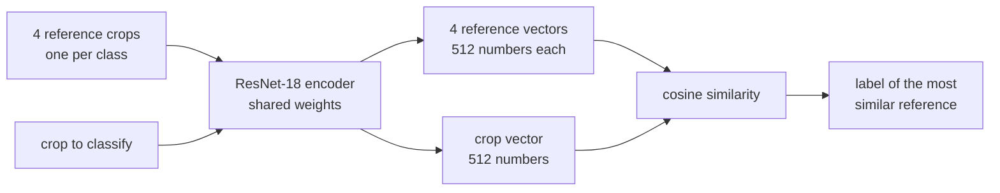
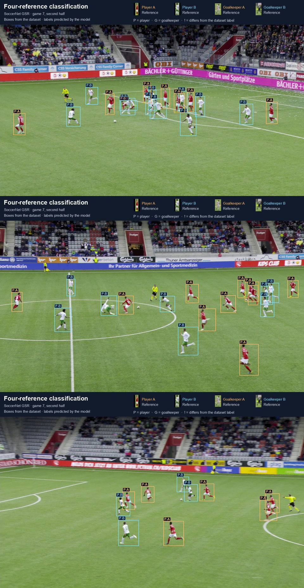

# Four-Reference Team Classifier


> **Historical release results below.** The original preprocessing treated SoccerNet's camera-relative `left`/`right` as stable team identities across clips. The corrected preprocessing aligns team identities within each half. The original evaluation also used later jersey labels to choose references and to exclude the same outfield athletes from scoring; it describes a retrospective comparison, not a prospective deployment test. Do not cite these release metrics as results of the corrected protocol.

This model sorts the player boxes of a football match into four groups: outfield players of team A, outfield players of team B, goalkeeper A and goalkeeper B. It needs one example crop of each group, taken from the same match.

It is a ResNet-18 fine-tuned to compare a crop with those four examples. On three matches held out from training, it labels 91.65% of 2,671 boxes correctly. With the original ImageNet weights, the same examples and the same boxes, it labels 53.61%.

A second model takes six example crops of each group instead of one. On the same boxes its overall accuracy is the same (91.54%), and it gets more goalkeepers right: 94.81% and 91.36% instead of 83.12% and 85.19%.

<p align="center">
  
</p>

Twelve seconds of a test match ([full-resolution video](media/classification-game-7.mp4)). The boxes come from the dataset annotations; the model assigns each label one box at a time, with no tracking and no smoothing across frames. Orange is team A, blue is team B, `P` is an outfield player, `G` is a goalkeeper, and `!` marks a prediction that differs from the dataset label.

## The task

| | |
|---|---|
| **Given once per match** | Reference crops for player A, player B, goalkeeper A and goalkeeper B: one of each, or six of each |
| **Given afterwards** | Any number of player crops from the same match |
| **Returned** | One of the four labels for each crop |

There is no detector and no tracker here: boxes are an input. "Team A" has no fixed appearance either. It can wear red in one match and white in the next, so the model cannot learn "red means A". It has to learn to compare a crop with the references it was handed.

## How it works



The four reference vectors are computed once per match. After that, each new box costs one forward pass and four dot products.

### What was changed in ResNet-18

The residual blocks are the standard torchvision ones. Three things around them changed:

| | torchvision ResNet-18 | This repository |
|---|---|---|
| **Output** | 1,000-way ImageNet classifier | Classifier removed; the network returns a 512-number vector per crop |
| **Weights** | ImageNet | Stem, `layer1` and `layer2` kept frozen (0.68 M parameters); `layer3` and `layer4` fine-tuned (10.49 M); batch-norm running statistics kept from ImageNet |
| **Decision** | Fixed set of classes | Cosine similarity between the crop vector and the four reference vectors of that match; the highest wins |
| **Input** | 224 × 224 image | 96 × 48 crop, aspect ratio preserved on a black canvas |

### How it is trained

Training repeats the task itself. Each step draws one session (one half of one match), one reference per class from the early part of it, and up to four later boxes per class. The loss is cross-entropy over the four similarities, so the correct reference has to score highest.

For outfield players, the boxes to classify always belong to **a different athlete** than the reference of that class, identified by jersey number. This forces the network to match the kit instead of the person.

The run is 8 epochs of 180 steps with AdamW (learning rate 2e-4, weight decay 1e-4, cosine schedule) and seed 25. On an Apple-silicon GPU it takes about one minute.

### Six references per class

The second model receives six crops of each group. Each crop goes through the encoder, the six vectors of a group are normalised and averaged, and the average is that group's reference. The decision is still four cosine similarities, and each new box is still one forward pass.

The six crops of a group are the original reference plus five earlier frames of the same session, drawn at random. For outfield players they show the same athlete as the original reference. They come from a bank of earlier crops (`reference_bank.py`) that reads more frames than the 96 sampled per session, because the goalkeepers rarely appear often enough otherwise. Crops covered more than 75% by another person are skipped when enough clear ones exist.

This model is trained from the same ImageNet weights with the same recipe: optimizer, learning-rate schedule, 8 epochs of 180 steps and seed 25. Its checkpoint (epoch 2) was chosen on validation, where it reaches 89.10% of the 3,193 boxes against 85.03% for the one-reference model.

## Data

[SoccerNet Game State Reconstruction 2025](https://huggingface.co/datasets/SoccerNet/SN-GSR-2025) provides 30-second broadcast clips in which every box carries a role (`player`, `goalkeeper`, …) and a team (`left` or `right`). Here `left` is team A and `right` is team B.

Many clips show only one of the goalkeepers, so `prepare.py` pools the clips of the same match and the same half into one **session**, samples up to 96 frames from it, and picks a cut-off time: references come from before the cut-off, the boxes to classify from after it.

| Split | Matches (dataset `game_id`) | Clips | Sessions | Crops |
|---|---|---:|---:|---:|
| Train | 4, 6, 9 | 57 | 6 | 7,161 |
| Validation | 2, 3, 5 | 58 | 6 | 7,308 |
| Test | 7, 8, 11 | 49 | 6 | 6,441 |

Referees, the ball and other people are ignored. Outfield players whose jersey number is not annotated (3,410 boxes) are left out, because without a number the "different athlete" rule cannot be checked.

### Why the test score is not memorisation

- **Whole matches are held out.** The three splits share no `game_id`; `prepare.py` refuses to continue otherwise and the audit is in [`results/audit.json`](results/audit.json).
- **No crop appears twice.** Pixel hashes of all 20,910 crops show zero duplicates across splits ([`results/verification.json`](results/verification.json)).
- **The test set was opened once per model.** Each checkpoint (epoch 6 for one reference, epoch 2 for six) was chosen on validation before any test crop was read; the order is visible in [`results/training.log`](results/training.log) and [`results/six-references.log`](results/six-references.log).
- **References come first.** Every evaluated box is later in the match than all of its references.
- **Other athletes.** Evaluated outfield boxes never share the jersey number of their class reference.
- **Same boxes for every model.** The frozen ImageNet ResNet-18 and the six-reference model are scored on exactly the same boxes as the one-reference model.

## Results

Test split: three matches, six sessions, 2,671 boxes.

| | Boxes | Frozen ImageNet ResNet-18, 1 reference | Fine-tuned, 1 reference | Fine-tuned, 6 references |
|---|---:|---:|---:|---:|
| Player, team A | 1,295 | 54.90% | **90.50%** | 90.42% |
| Player, team B | 1,218 | 54.02% | **93.84%** | 92.53% |
| Goalkeeper, team A | 77 | 40.26% | 83.12% | **94.81%** |
| Goalkeeper, team B | 81 | 39.51% | 85.19% | **91.36%** |
| **All boxes** | **2,671** | **53.61%** | **91.65%** | **91.54%** |
| **Mean of the four classes** | | **47.17%** | **88.16%** | **92.28%** |

Six references do not change the overall score: 2,445 correct boxes against 2,448. They change where the errors are. The goalkeepers gain 14 correct boxes out of 158, and the outfield players of team B lose 16 out of 1,218. Because the four classes are so unbalanced, the mean over the four classes rises by four points while the overall accuracy stays put.

Per match:

| Test match | Boxes | Frozen, 1 reference | Fine-tuned, 1 reference | Fine-tuned, 6 references |
|---|---:|---:|---:|---:|
| Game 7 | 843 | 39.38% | 81.14% | 81.61% |
| Game 8 | 1,030 | 61.84% | 96.21% | 95.34% |
| Game 11 | 798 | 58.02% | 96.87% | 97.12% |

On the validation matches the one-reference model reaches 85.03% of 3,193 boxes (88.09% class mean), the six-reference model 89.10% (92.82%), and the frozen one 54.87% (50.42%). The validation gain of the six-reference model did not carry over to the overall test accuracy. Full confusion matrices and per-session numbers are in [`results/result.json`](results/result.json) and [`results/six-references.json`](results/six-references.json).

## Speed and precision

The six-reference model was exported in three precisions and run on each compute unit of an Apple M4 Pro. Every row below classifies the same 2,671 test boxes with the same references, and times one batch of 20 boxes, about how many players a broadcast frame shows. Measured with `evaluate_formats.py`; the full numbers are in [`results/formats.json`](results/formats.json).

| Compute unit | Runtime | Precision | Test accuracy | Mean of the four classes | 20 boxes | Frames per second |
|---|---|---|---:|---:|---:|---:|
| CPU | PyTorch | FP32 | 91.54% | 92.28% | 95.00 ms | 11 |
| CPU | Core ML | INT8 | 91.54% | 92.28% | 7.81 ms | 128 |
| GPU | PyTorch | FP32 | 91.54% | 92.28% | 11.09 ms | 90 |
| GPU | PyTorch | FP16 | 91.54% | 92.28% | 11.87 ms | 84 |
| GPU | Core ML | INT8 | 91.65% | 92.34% | 6.83 ms | 146 |
| Neural Engine | Core ML | FP16 | 91.50% | 92.26% | 2.67 ms | 375 |
| **Neural Engine** | **Core ML** | **INT8** | **91.54%** | **92.28%** | **2.30 ms** | **434** |

What to use:

| Compute unit | Model | Why |
|---|---|---|
| Neural Engine | [`models/six-references-int8.mlpackage`](models/six-references-int8.mlpackage) | Fastest configuration measured, same accuracy as FP32 |
| GPU | [`models/six-references-int8.mlpackage`](models/six-references-int8.mlpackage) | Faster than PyTorch on the GPU at the same accuracy |
| CPU on a Mac | [`models/six-references-int8.mlpackage`](models/six-references-int8.mlpackage) | 12 times faster than PyTorch FP32 on the CPU, same accuracy |
| CPU elsewhere | [`models/six-references.pth`](models/six-references.pth) | Core ML only runs on Apple platforms; FP32 is the reference result |

The INT8 model quantizes both the weights and the activations. Its scales were calibrated on 240 crops from the training matches only, and the network was not retrained. Core ML's compute plan places all 20 convolutions on the requested unit in every Core ML row. Across the seven rows the number of correct boxes stays between 2,444 and 2,448 out of 2,671.

The 24 reference crops (six per class) go through the network once, as one batch, and are reduced to four vectors; on the Neural Engine this takes 4.30 ms once per match. After that, every box costs one forward pass, exactly as with a single reference. Send the boxes of a frame together: the network is much faster per box in a batch than one box at a time. On the GPU, PyTorch FP16 showed no consistent gain over FP32 in this measurement; repeated runs varied by about one millisecond. The timings exclude video decoding, producing the boxes and cutting the crops, which takes about 0.6 ms for 20 boxes.

## What it looks like

These images and the video at the top come from the one-reference model. Each sheet shows the four references it received, one later box per class it labelled correctly, and one it got wrong. Both matches are from the test split.

<p align="center">
  
  
</p>

Team A wears white in game 11 and red in game 7: the label follows the references, not a colour. Game 7, second half, is the hardest session (75.63%); one of its mistakes is a box annotated as goalkeeper B that shows almost only grass.

About the video at the top: the 12-second window was picked because both goalkeepers are visible in it, not for its score. In that window 2,368 of 2,443 boxes (96.93%) match the dataset label ([stats](media/classification-game-7-stats.json)). It draws every labelled player box of consecutive frames from a single clip, so it is not the same population as the test metric, and it is easier than the full session it belongs to.

<p align="center">
  
</p>

## Reproduce

```bash
python -m venv .venv && source .venv/bin/activate
pip install -r requirements.txt

./download.sh                                 # pinned dataset revision (~30 GB) and ImageNet weights
./run.sh                                      # verify checksums, build sessions, train and test both models
python visualize.py --root data --out media   # example sheets, video and GIF (needs ffmpeg)
python benchmark.py                           # frames per second on this machine
pip install -r requirements-coreml.txt        # macOS only, for the next two lines
python quantize.py --root data                # FP16 checkpoint and Core ML INT8 package
python evaluate_formats.py --root data        # accuracy and latency per compute unit and precision
```

`run.sh` trains the one-reference model (`data/work/checkpoint.pth`, `data/work/result.json`), builds the reference bank (`data/work/references/`, about 4 GB) and trains the six-reference model (`data/work/six-references/`). The full run takes about ten minutes on an Apple-silicon GPU. A fresh run of these scripts (PyTorch 2.9.1) reproduced `results/result.json` and the one-reference checkpoint byte for byte, and the six-reference validation results epoch by epoch. Other hardware or library versions may differ in the last digits.

### Trained models

All models are in [`models/`](models) and attached to the [v1.2 release](https://github.com/Hmenez3s/four-reference-team-classifier/releases/tag/v1.2).

| File | References per class | SHA-256 |
|---|---:|---|
| [`models/one-reference.pth`](models/one-reference.pth) | 1 | `e85b9de6153db41c3dac9a5139f81f1ca76a2db7aecc99610ade35b3ee5c210a` |
| [`models/six-references.pth`](models/six-references.pth) | 6 | `945d904e6daa63718efa01c022f23163358d68f45072f26cf99c17bcbe9c635c` |
| [`models/six-references-fp16.pth`](models/six-references-fp16.pth) | 6, FP16 weights | `5f4f30efde460afcedb2cf14f03047bcd572fd208a1cab48e7db6e2c347d6289` |
| [`models/six-references-int8.mlpackage`](models/six-references-int8.mlpackage) | 6, Core ML INT8 (11 MB) | weights `1f51249fb650259a3c213bce0fdf9e204136c340b91d2736568df2d92b6db3a7` |

The FP16 and INT8 files are derived from `six-references.pth` by `quantize.py`. The Core ML package takes exactly 20 normalised crops per call (pad the last batch) and returns their 512-number vectors; the comparison with the references stays in Python.

### Classify your own boxes

`prepare.crop_box(image, {"x_center": …, "y_center": …, "w": …, "h": …})` turns a box of a PIL image into the 96 × 48 crop the model expects. With the reference crops stacked in class order and the boxes to classify stacked in a second array:

```python
import torch
import six_references
import train

device = torch.device("mps" if torch.backends.mps.is_available() else "cpu")
model = train.build_model("data/inputs/resnet18.pth", device)
state = torch.load("models/six-references.pth", map_location=device, weights_only=True)
model.load_state_dict(state["model"])
model.eval()

per_class = len(reference_crops) // 4
with torch.no_grad():
    references = six_references.class_prototypes(model(six_references.batch_crops(reference_crops, device)), per_class)
    boxes = model(six_references.batch_crops(box_crops, device))
labels = train.cosine_logits(boxes, references).argmax(dim=1).tolist()
```

With the Core ML INT8 package on a Mac, the same comparison runs on the Neural Engine:

```python
import coremltools as ct
import numpy as np
import six_references
import torch

model = ct.models.MLModel("models/six-references-int8.mlpackage", compute_units=ct.ComputeUnit.CPU_AND_NE)

def embed(crops):
    data = six_references.batch_crops(crops, torch.device("cpu")).numpy()
    out = []
    for start in range(0, len(data), 20):
        chunk = data[start:start + 20]
        padded = np.concatenate([chunk, np.repeat(chunk[-1:], 20 - len(chunk), axis=0)])
        out.append(model.predict({"crops": padded})["embedding"][:len(chunk)])
    vectors = np.concatenate(out)
    return vectors / np.linalg.norm(vectors, axis=1, keepdims=True)

references = embed(reference_crops).reshape(4, 6, -1).mean(axis=1)
references /= np.linalg.norm(references, axis=1, keepdims=True)
labels = (embed(box_crops) @ references.T).argmax(axis=1)
```

`reference_crops` is a `uint8` array of shape `[4 × k, 96, 48, 3]`: the k crops of player A, then player B, goalkeeper A and goalkeeper B. Use k = 6 with `models/six-references.pth` and k = 1 with `models/one-reference.pth`. `box_crops` has shape `[N, 96, 48, 3]`, and `labels` holds an index into `train.CLASSES` for each box. Only `data/inputs/resnet18.pth` from `download.sh` is needed for this; the dataset is not.

## Limits

- **Small test.** Three test matches and one training seed. Accuracy per match ranges from 81.14% to 96.87%, and there are no confidence intervals. Read 91.65% as "it worked on these three matches", not as an expected score on any match.
- **Goalkeepers are measured on few boxes.** 77 and 81 test boxes. With one reference they are the weak spot (83.12% and 85.19%); six references bring them to 94.81% and 91.36%, a gain of 14 boxes.
- **One set of references per session.** Each session was scored with a single choice of references; the sensitivity to which crops are used as references was not measured.
- **Ground-truth boxes.** Boxes come from the annotations. Errors of a real detector are not part of the score.
- **Four classes only.** The model always answers one of the four labels. A referee, a substitute or an empty box would still receive one.
- **Per-half sessions.** The dataset's `left`/`right` team labels are assumed stable within a half; references are not carried across half-time.
- **Annotated numbers only.** Outfield players without an annotated jersey number are excluded from training and from the reported metric.

## Repository layout

| Path | Purpose |
|---|---|
| `download.sh` | Fetches the pinned dataset revision and the ImageNet ResNet-18 weights into `data/` |
| `checksums.sha256` | SHA-256 of every downloaded file, checked by `run.sh` |
| `prepare.py` | Builds match-disjoint sessions and letterboxed crops straight from the ZIP archives |
| `train.py` | Model, episodic training, validation-based checkpoint selection and the test evaluation with one reference |
| `reference_bank.py` | Bank of earlier crops per session, used to draw the extra references |
| `six_references.py` | Training, checkpoint selection and test evaluation with six references per class |
| `visualize.py` | Example sheets, the classified video and its GIF |
| `benchmark.py` | Timing of cropping, reference encoding and classification per frame |
| `quantize.py` | FP16 checkpoint and Core ML INT8 package, calibrated on training crops |
| `evaluate_formats.py` | Test accuracy and latency for each compute unit and precision |
| `run.sh` | Runs checksum verification, `prepare.py`, `train.py`, `reference_bank.py` and `six_references.py` in order |
| `models/` | The one- and six-reference checkpoints, plus the FP16 and Core ML INT8 exports |
| `results/` | Metrics, split audit, duplicate-crop check and training logs of both models |
| `media/` | Images and video shown in this README |

## License

The code is released under the [MIT License](LICENSE). The dataset, the frames shown in `media/` and the ImageNet weights are third-party material under their own terms; see [NOTICE.md](NOTICE.md).
